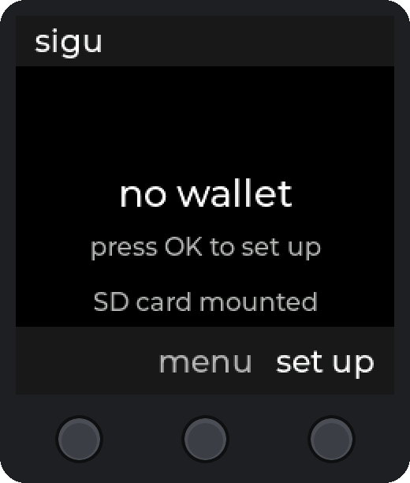

<h1 align="center">sigu</h1>
<p align="center"></p>
<p align="center"><b><a href="https://milrt.github.io/sigu-firmware/">Try it in the Browser</a></b></p>

A Bitcoin-only hardware wallet on the nRF54L15 with TF-M.

**Early development: don't use it with real funds.**

The chip is split with TrustZone. The secure partition holds the seed and the keys, builds the
sighash, and owns the screen and the buttons. The non-secure side parses PSBTs and runs the SD
card, and is not trusted. SD card only, no USB data, no radio.

Works:
- Wallet on the device: 12 or 24 words, BIP39 passphrase, PIN
- Sign PSBTs from the SD card: single-sig P2WPKH, review on the screen
- Watch-only export and receive addresses, with QR codes
- Signed firmware updates with rollback
- nRF54L15-DK with an ST7789 screen, three buttons and an SD card
  ([wiring](ARCHITECTURE.md#hardware))

Not yet: Taproot, multisig, custom hardware.

## Simulator

No board and no NCS. It needs cmake, SDL2, git and Python 3.10 or newer.

```sh
brew install cmake sdl2 python   # macOS
sudo apt install build-essential cmake libsdl2-dev git python3-venv   # Debian / Ubuntu
```

The repo sits in a folder of its own, the west workspace, with `external/` next to it. The repo
folder must be named `sigu-firmware`. The project filter fetches only what the sim needs
(MCUboot, the bitcoin libraries, the QR code encoder and the sdk-nrf manifest, about 260 MB):

```sh
mkdir sigu && cd sigu
git clone https://github.com/milrt/sigu-firmware
python3 -m venv .venv && source .venv/bin/activate
pip install west -r sigu-firmware/sim/requirements.txt
west init -l sigu-firmware
west config manifest.project-filter -- \
  '-.*,+sdk-nrf,+mcuboot,+secp256k1,+bips,+libbase58,+QR-Code-generator'
west update --narrow -o=--depth=1
```

Build, run and test, from `sigu-firmware/`:

```sh
cmake -S sim -B sim/build && cmake --build sim/build -j
sim/build/sigu-sim
python sim/tests/run.py
```

The web build, scripting and fuzzing are in [sim/README.md](sim/README.md).

## Board

It needs the nRF Connect SDK v3.4.0 toolchain,
[nrfutil](https://www.nordicsemi.com/Products/Development-tools/nRF-Util) and the
[J-Link software](https://www.segger.com/downloads/jlink/). nrfutil is a single binary from
Nordic. Put it on the PATH:

```sh
mkdir -p ~/.local/bin   # must be on the PATH
# macOS (Apple silicon and Intel)
curl -fLo ~/.local/bin/nrfutil https://files.nordicsemi.com/artifactory/swtools/external/nrfutil/executables/universal-apple-darwin/nrfutil
# Debian / Ubuntu (x86_64; on arm64, use aarch64-unknown-linux-gnu)
curl -fLo ~/.local/bin/nrfutil https://files.nordicsemi.com/artifactory/swtools/external/nrfutil/executables/x86_64-unknown-linux-gnu/nrfutil
chmod +x ~/.local/bin/nrfutil
```

Then install the toolchain with nrfutil (or see the
[NCS installation](https://docs.nordicsemi.com/bundle/ncs-latest/page/nrf/installation.html)):

```sh
nrfutil install sdk-manager device
nrfutil sdk-manager toolchain install --ncs-version v3.4.0
```

The commands below run in the toolchain shell. Open one in any terminal or editor:

```sh
nrfutil sdk-manager toolchain launch --ncs-version v3.4.0 --shell
```

Or load the toolchain into the shell you are in. You can put the line in `~/.zshrc` or in a
direnv `.envrc`:

```sh
eval "$(nrfutil sdk-manager toolchain env --as-script sh --ncs-version v3.4.0)"
```

The toolchain puts its own Python first on the PATH, and it does not have the sim's packages.
In that shell, run the sim tests with the venv's Python: `../.venv/bin/python sim/tests/run.py`
(or `sim/.venv/bin/python`, with the venv from [sim/README.md](sim/README.md#tests)).

The [nRF Connect for VS Code](https://marketplace.visualstudio.com/items?itemName=nordic-semiconductor.nrf-connect)
extension installs the same toolchain, and nrfutil finds it.

In the workspace (`sigu/`), fetch all of NCS (about 1.6 GB) and apply the patches. Drop the
sim's project filter first if you set it. Run the last two again after a pull that changes
`west.yml` or `zephyr/patches.yml`:

```sh
west config -d manifest.project-filter   # only after the sim setup
west update --narrow -o=--depth=1
west patch clean && west patch apply
```

The dev build, from `sigu-firmware/`: debug port open, NCS debug keys.

```sh
west build -p -b nrf54l15dk/nrf54l15/cpuapp/ns -d app/build app -- \
  -DSB_EXTRA_CONF_FILE=sysbuild_dev.conf -DEXTRA_CONF_FILE=prj_dev.conf

west flash -d app/build --recover               # first time: erases the chip, wallet included
west flash -d app/build --domain app -r jlink   # after that: keeps the wallet
```

`--recover` needs the default nrfutil runner, which erases the chip and provisions the b0 and
MCUboot keys into KMU. J-Link can do neither. For `--domain app`, use J-Link: nrfutil halts the
running chip without a reset, and when the core stops in non-secure code its writes to secure
slot0 fail with `Memory access error at 0x00034000`.

## Without installing anything

`docker/Dockerfile` has every tool for the firmware, the sim, the tests and the web build. CI
builds in it. From the workspace (`sigu/`):

```sh
docker build -t sigu-build -f sigu-firmware/docker/Dockerfile sigu-firmware
docker run --rm -it -u "$(id -u):$(id -g)" -e HOME=/tmp -v "$PWD:/work" -w /work sigu-build
```

West is in the image, so the west and build commands above work as written. The container has
no display and no USB: run the sim with `--headless` or use the web build, and flash from a
native build. A CMake build folder holds absolute paths, so use other build folders in the
container than on the host. The image has a user `dev` and keeps its PATH in login shells, so it
also works as the base of your own dev container.

## Editor

clangd editors need one compile database. Build the board and the sim, then run
`./compdb.py`. It links the database into the workspace folder, so files in `external/` resolve
too. Start clangd with `--query-driver=**/arm-zephyr-eabi-gcc`.

Design, threat model, release build and firmware updates: [ARCHITECTURE.md](ARCHITECTURE.md).

License: GPL-3.0-or-later ([LICENSE](LICENSE)). Third-party parts: [THIRD_PARTY.md](THIRD_PARTY.md).
